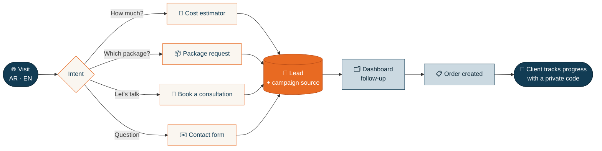
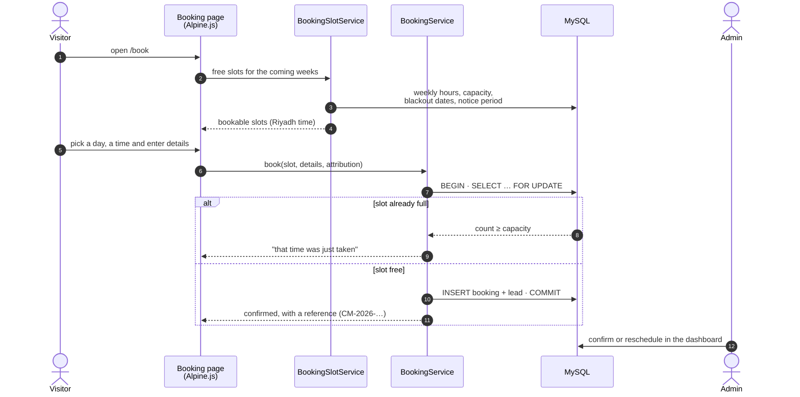
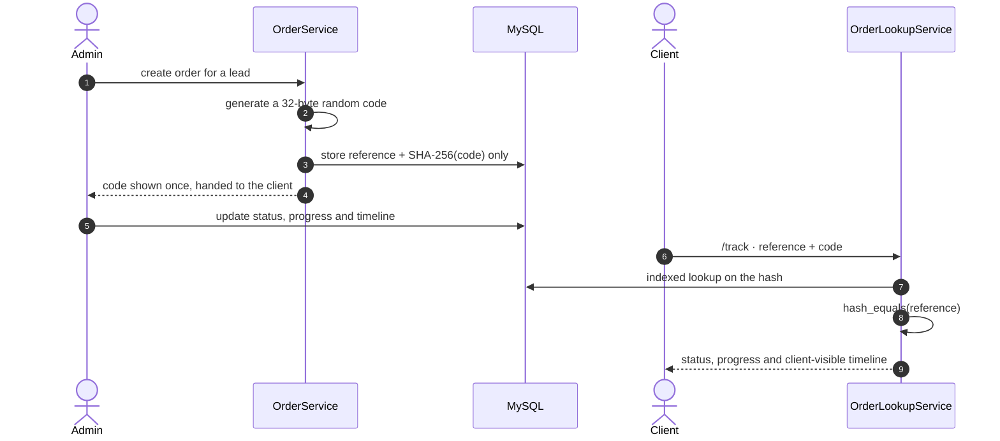
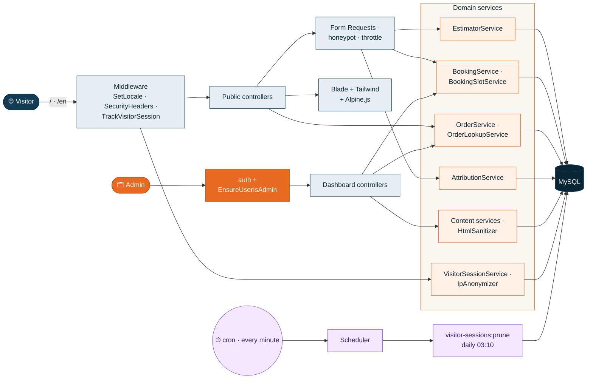
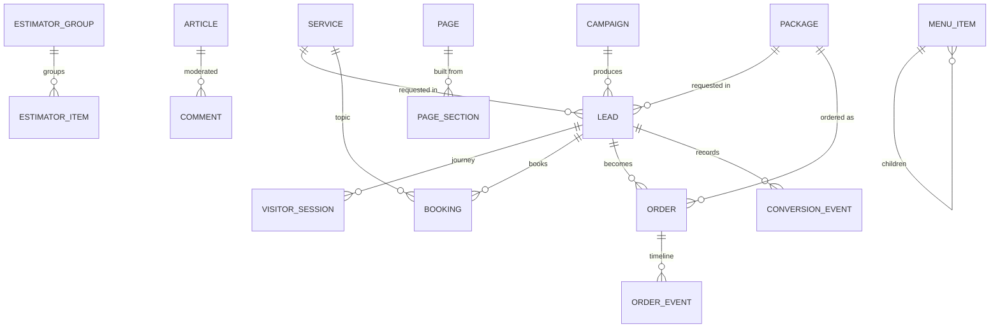
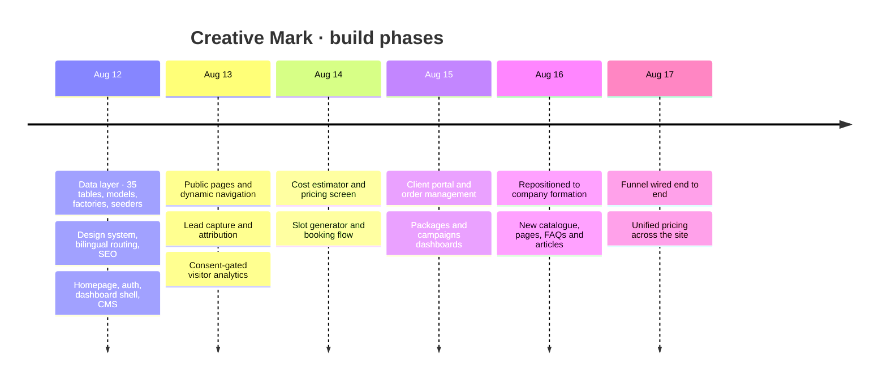

<div align="center">

<picture>
  <source media="(prefers-color-scheme: dark)" srcset="public/logo-light.png">
  
</picture>

# Creative Mark · صنّاع العلامات التجارية

**A bilingual (Arabic / English) company-formation and investment platform for Saudi Arabia: public website, live cost estimator, consultation booking, client order tracking and a full admin dashboard.**


<br>


[Overview](#-overview) · [Screenshots](#-screenshots) · [Features](#-features) · [How it works](#-how-it-works) · [Architecture](#-architecture) · [Quality](#-quality-in-numbers) · [Getting started](#-getting-started) · [Deployment](#-deployment) · [Roadmap](#%EF%B8%8F-roadmap) · [العربية](#-نبذة-بالعربية)

<br>


</div>

---

## 🏛️ Overview

**Creative Mark** is a Saudi advisory firm that takes founders and foreign investors from an idea to an active Commercial Registration: company formation, foreign-investment licences, acquisition of existing companies, and every government procedure in between.

This repository is the firm's complete web platform. It covers the **whole client journey**, from the first visit to a delivered order:



Everything a visitor reads, every price they see and every slot they can book is managed from the dashboard, with no code changes and no database access.

| | |
|---|---|
| 🌍 **Languages** | Arabic (primary, right-to-left) and English, on every page and every content field |
| 🖥️ **Public pages** | Home, Services, Activities, Packages, Cost Estimator, Booking, Order Tracking, Countries, Blog, FAQs, About, Our Process, Why Saudi Arabia, Contact, Privacy, Terms |
| 🗂️ **Dashboard** | 23 sections covering leads, orders, bookings, campaigns, visitor sessions, content, pricing and settings |
| 🗄️ **Data model** | 35 tables · 27 Eloquent models, every one with a factory |
| ✅ **Test suite** | 1,366 tests · 4,343 assertions, green on SQLite and MySQL |

---

## 📸 Screenshots

### Public website

| Homepage · Arabic (RTL) | Homepage · English |
|---|---|
|  |  |

| Cost estimator with a live total | Formation packages |
|---|---|
|  |  |

| Consultation booking | Order tracking portal |
|---|---|
|  |  |

<details>
<summary><b>More public pages: services, blog, FAQs, contact</b></summary>
<br>

| Services | Blog |
|---|---|
|  |  |

| FAQs | Contact |
|---|---|
|  |  |

</details>

### Mobile first

<p align="center">
  
  &nbsp;
  
  &nbsp;
  
</p>

### Admin dashboard (`/dashboard`)

| Overview | Orders |
|---|---|
|  |  |

| Leads | Visitor sessions |
|---|---|
|  |  |

<details>
<summary><b>More dashboard screens: bookings, campaigns, pricing, packages, pages, settings, tracking</b></summary>
<br>

| Bookings | Campaigns |
|---|---|
|  |  |

| Estimator pricing | Packages |
|---|---|
|  |  |

| Pages and sections | Settings |
|---|---|
|  |  |

| Tracking and consent | |
|---|---|
|  | |

</details>

> Dashboard screenshots use the bundled demo data (`DemoDataSeeder`), so every name in them is marked *sample data*.

---

## ✨ Features

<details open>
<summary><b>🌐 Public website</b></summary>

- **Fully bilingual, RTL-first.** Arabic at `/`, English at `/en/…`, with mirrored layouts, `hreflang` alternates and a language switch that keeps you on the same page.
- **Formation packages.** Three published packages (Basic, Integrated, Comprehensive) with prices and feature lists, and a request form that pre-selects the chosen package.
- **Live cost estimator.** Visitors pick a formation type and add services from grouped selectors. The total updates instantly, items priced on request are flagged honestly, and the selection can be sent as a lead in one step.
- **Consultation booking.** A real availability engine: weekly hours, slot length, per-slot capacity, blackout dates and minimum notice. Times are shown in Riyadh time and stored in UTC, and a full slot cannot be double-booked.
- **Order tracking portal.** Clients follow their order's status, progress and timeline with a private tracking code, without creating an account.
- **Editorial content.** Services, activities, countries, blog articles with moderated comments, FAQs, and static pages built from reorderable sections.
- **SEO built in.** Per-page meta and Open Graph tags, canonical URLs, a `sitemap.xml` generated from the real routes, `robots.txt`, and branded 403 / 404 / 419 / 500 / 503 pages.

</details>

<details open>
<summary><b>🗂️ Admin dashboard</b></summary>

| Area | What it does |
|---|---|
| 🎯 **Leads** | Every enquiry from every form in one inbox, with its source, UTM campaign and handled state |
| ✉️ **Contact messages** | A separate queue for contact-form messages, with unread badges |
| 📋 **Orders** | Create orders, set status and progress, write a client-visible timeline, issue or reissue tracking codes |
| 📅 **Bookings** | List and agenda views, a status workflow, weekly availability and blackout dates |
| 📣 **Campaigns** | Marketing campaigns, linked back to the leads they produced |
| 👣 **Visitor sessions** | Consent-gated visitor journeys (entry page, pages viewed, device, source, conversion), with JSON export |
| 💰 **Pricing** | One price per item, set once, live on both the packages page and the estimator |
| 📝 **Content** | Services, packages, articles, comments, FAQs, testimonials, countries, pages and sections, menu order and visibility, media library |
| ⚙️ **Settings** | Contact details, social links, homepage stats, booking rules, and GA4 / GTM / Meta / TikTok pixels behind a consent gate |

The dashboard has its own Arabic / English toggle, independent of the public site.

</details>

<details open>
<summary><b>📈 Marketing and analytics</b></summary>

- **Attribution.** UTM parameters and referrers are captured as first-touch and latest-touch snapshots and stored on the lead the visitor eventually submits.
- **Privacy-first visitor journeys.** Recorded server-side, off the critical rendering path, only after consent, and never when the browser sends Do Not Track or Global Privacy Control.
- **Consent-gated pixels.** Marketing scripts load only after the visitor accepts.
- **Automatic retention.** A scheduled job deletes visitor sessions older than the configured window (90 days by default).

</details>

---

## 🔄 How it works

### Booking a consultation



### Tracking an order



---

## 🧭 Architecture



- **Thin controllers.** Controllers validate through Form Requests and delegate. Every workflow (quoting, booking, order status, publishing) lives in one service with one responsibility.
- **One source of truth for prices.** A package or service price is set once in the dashboard and read by both the packages page and the estimator.
- **Content is data.** Navigation, page sections, FAQs, prices, contact details and pixel IDs are all managed from the dashboard.
- **Production and demo data never mix.** `migrate --seed` installs real content only. Demo records live in separate `Demo*` seeders, and a test scans every readable column to keep it that way.
- **Clean rollbacks.** Indexes are declared inside `CREATE TABLE`, so every `down()` is a plain drop. A test runs the full migrate → rollback → migrate cycle.

### Core data model



### Project structure

```
app/
├── Console/Commands/      # visitor-sessions:prune · content:translate-to-english
├── Http/
│   ├── Controllers/
│   │   ├── Public/        # 15 controllers: site, forms, estimator, booking, tracking
│   │   └── Dashboard/     # 24 controllers: the admin dashboard
│   ├── Middleware/        # SetLocale · SetDashboardLocale · EnsureUserIsAdmin ·
│   │                      # SecurityHeaders · TrackVisitorSession
│   └── Requests/          # one Form Request per write action
├── Models/                # 27 models + shared concerns (slugs, translations)
├── Services/              # all business logic lives here
│   ├── Analytics/         # consent gate, IP anonymiser, sessions, user-agent parsing
│   ├── Booking/           # slot generator, availability, status workflow, notifier
│   ├── Cms/               # content services, settings, menu, media, HTML sanitiser
│   ├── Crm/               # contact messages
│   ├── Estimator/         # quote calculation
│   ├── Marketing/         # campaigns, attribution
│   ├── Orders/            # orders, timeline, tracking-code lookup, reports
│   └── Seo/               # meta tags and SEO records
└── Support/               # CalendarDate · Honeypot
database/
├── migrations/            # 35 tables, indexes declared inside CREATE TABLE
├── factories/             # a factory for every model
└── seeders/               # production content, kept apart from Demo* seeders
lang/{ar,en}/              # site.php · dashboard.php
resources/views/
├── public/ · dashboard/   # page templates
├── components/            # shared Blade components (public, dashboard, SEO, tracking)
└── errors/                # branded error pages
docs/                      # data-layer reference, deployment guide, screenshots
```

### Tech stack

| Layer | Technology |
|---|---|
| Backend | Laravel 12 · PHP 8.2+ |
| Database | MySQL 8 (SQLite in-memory for tests) |
| Frontend | Blade · Tailwind CSS 3 · Alpine.js 3 (+ Focus) · Vite 7 |
| Translations | `spatie/laravel-translatable`: every human-readable field is a JSON column |
| Rich text | `mews/purifier` (HTML Purifier) for all admin-authored HTML |
| Auth | Laravel Breeze, with public registration removed and an admin gate |
| Tooling | PHPUnit 11 · Laravel Pint · Laravel Pail |

---

## 📊 Quality in numbers

| Check | Result |
|---|---|
| Automated tests | **1,366** passing · **4,343** assertions · ~49 s |
| Databases | Green on **SQLite** (in-memory) and **MySQL 8** |
| Route sweep | Every public and dashboard GET route renders in **both languages**, and no dashboard page leaks to a non-admin |
| Booking race | Concurrent requests for the last seat in a slot: exactly one wins |
| Translations | No missing, duplicate or leaked keys in `ar` or `en` |
| Accessibility | Brand text and background pairs pinned to **WCAG** contrast ratios |
| Data safety | Mass-assignment guards, index placement, a full migrate / rollback cycle, and demo-data separation are all tested |
| Regressions | English package names, features and estimator totals locked in place |
| Code style | Laravel Pint, passing |

---

## 🔐 Security and privacy

| Concern | Implementation |
|---|---|
| **Admin access** | Public registration removed; every dashboard route is behind `auth` and an `EnsureUserIsAdmin` gate |
| **Mass assignment** | `is_admin`, statuses, order progress, references and tracking hashes are outside `$fillable` and change only through explicit model methods; a test guards each one |
| **Tracking codes** | Only the SHA-256 of a 32-byte random value is stored. The code is shown once, cannot be recovered, and is required together with the reference |
| **IP addresses** | Truncated in a model mutator, so no code path can store a full address |
| **Rich text** | All admin HTML passes through HTML Purifier before storage |
| **Spam and abuse** | Honeypot fields on every public form; `throttle:5,1` on every public write and a dedicated limiter on order lookup |
| **Headers** | `X-Frame-Options`, `X-Content-Type-Options`, `Referrer-Policy`, `Permissions-Policy`, HSTS in production, a Content Security Policy, and `X-Powered-By` removed |
| **Consent** | Visitor tracking and marketing pixels run only after opt-in, and never under DNT or GPC |
| **Retention** | Visitor sessions are pruned daily by the scheduler |

---

## 🚀 Getting started

### Requirements

PHP 8.2+ (with `intl`, `mbstring`, `pdo_mysql`) · Composer 2 · Node 18+ · MySQL 8

### Local installation

```bash
git clone https://github.com/m77mdabdo/Brand_Makers.git
cd Brand_Makers

composer install
npm install

cp .env.example .env
php artisan key:generate
```

Set `DB_DATABASE`, `DB_USERNAME` and `DB_PASSWORD` in `.env`. Outside a local environment, also set `ADMIN_EMAIL` and `ADMIN_PASSWORD`; the admin seeder refuses to fall back to placeholder credentials anywhere else.

### Database

```bash
php artisan migrate --seed                    # schema + real production content
php artisan db:seed --class=DemoDataSeeder    # optional: sample leads, orders, bookings, campaigns
```

### Front-end and server

```bash
npm run build        # or `npm run dev` while developing
php artisan serve    # or `composer dev`: server, queue, logs and Vite together
```

Open `http://127.0.0.1:8000` for the Arabic site, `/en` for English, and `/login` for the dashboard.

### Tests and code quality

```bash
php artisan test                                                        # SQLite, in-memory
DB_CONNECTION=mysql DB_DATABASE=brand_makers_testing php artisan test   # against MySQL
./vendor/bin/pint                                                       # code style
```

---

## ⏱️ Scheduled jobs

| Command | Schedule | Purpose |
|---|---|---|
| `visitor-sessions:prune` | daily · 03:10 | Deletes visitor sessions past the retention window (90 days by default, editable in Settings) |
| `content:translate-to-english` | on demand | Fills missing English translations for seeded content |

Production needs one cron entry: `* * * * * cd /path/to/app && php artisan schedule:run >> /dev/null 2>&1`

---

## 🚢 Deployment

A full step-by-step guide for Hostinger (hPanel, LiteSpeed, MySQL) is in **[docs/DEPLOYMENT.md](docs/DEPLOYMENT.md)**: PHP settings, the document root, the production `.env`, the storage link, cron and the queue worker, caching, and a post-deploy checklist.

---

## 🗓️ Project timeline

Built in focused phases between **11 and 17 August 2026**: 56 commits, each one self-contained and tested.



| Phase | Delivered |
|---|---|
| **1 · Data layer** | Full schema and Eloquent models, a factory for every model, production and demo seeders kept separate, and the first data-layer test suite |
| **2 · Foundation** | Brand design system and frontend toolchain; bilingual routing, locale helpers and SEO tags; public layout and homepage; authentication with registration removed and the admin gate |
| **3 · CMS** | Dashboard shell and settings manager; branded error pages, sitemap and robots; content services with HTML sanitising; CRUD with tests for every content type |
| **4 · Lead capture** | Public content pages with dynamic navigation; every public form with lead capture and marketing attribution |
| **5 · Privacy-first analytics** | Consent gate; server-side visitor journeys; consent-gated pixels; journeys linked to enquiries; scheduled retention; the Visitor Sessions dashboard |
| **6 · Cost estimator** | Quote service, public estimator with lead capture, and the dashboard pricing screen |
| **7 · Booking** | References and timezones, slot generator and booking service, public booking flow, availability settings and the bookings dashboard |
| **8 · Client portal** | Order tracking portal; order management; packages and campaigns CRUD; one strict date validator shared by every dashboard filter; an accessible booking picker |
| **9 · Repositioning** | From branding services to company formation: priced packages, a rebuilt estimator catalogue, new pages (Activities, Why Saudi Arabia), new FAQs and articles, English translations of all content |
| **10 · Polish** | Site chrome rewritten and the funnel wired end to end; working menu reordering; regression guards; estimator rebuilt as admin-managed grouped selectors; **one price per item, live on both surfaces** |

---

## 🗺️ Roadmap

### ✅ Delivered

- [x] Bilingual public website, Arabic-first with full RTL, SEO, sitemap and branded error pages
- [x] Three priced formation packages with a request form
- [x] Live cost estimator with grouped, admin-managed selectors and lead capture
- [x] Consultation booking with an availability engine and race-safe slot capacity
- [x] Client order tracking with hashed, show-once tracking codes
- [x] Admin dashboard: 23 sections covering leads, orders, bookings, campaigns, content, pricing and settings
- [x] Marketing attribution (first and latest touch) linked to every lead
- [x] Consent-gated visitor analytics and pixels, with DNT / GPC respected and automatic retention
- [x] Security headers, throttling, honeypots, HTML sanitising and IP truncation
- [x] 1,366 automated tests, green on SQLite and MySQL

### 🟡 Implemented only in part

Stated plainly so nobody builds on an assumption:

- **Notifications.** `BookingNotifier` is in place and logs every event, but no mail transport is configured yet, so no email reaches clients or the team.
- **Content Security Policy** is sent in report-only mode. Enforcing it needs Alpine's CSP build and nonces.

### 🔜 Next

- [ ] **Launch data:** contact phone, email, WhatsApp, address, social links and homepage stats in *Settings*; the remaining estimator prices still marked "on request"
- [ ] **Analytics:** GA4, GTM, Meta and TikTok IDs in *Tracking*, then activate
- [ ] **Legal review** of the Privacy Policy and Terms
- [ ] **Email notifications** for new bookings, orders and enquiries, to the client and the team
- [ ] **Team management:** invite dashboard users and assign roles
- [ ] **Enforcing CSP** with Alpine's CSP build and nonces
- [ ] Absolute sitemap URL in `robots.txt`; document the `BOOKING_*` keys in `.env.example`
- [ ] Continuous integration on GitHub Actions (tests, Pint, build check)
- [ ] Refactors: merge the duplicate filter builders and status graphs, extract the shared public submission flow, add intrinsic image sizes

---

## 📚 Documentation

| Path | Contents |
|---|---|
| [docs/data-layer.md](docs/data-layer.md) | Every table and model, guarded columns, tracking codes, IP anonymisation, morph map, rollback safety, production vs demo seeding |
| [docs/DEPLOYMENT.md](docs/DEPLOYMENT.md) | Production deployment to Hostinger, end to end |
| [docs/screenshots/](docs/screenshots/) | Every screenshot used in this README |

---

<div dir="rtl">

## 🇸🇦 نبذة بالعربية

**صنّاع العلامات التجارية (Creative Mark)** منصة متكاملة لشركة استشارية سعودية متخصصة في تأسيس الشركات وتمكين الاستثمار في المملكة العربية السعودية:

- **الموقع:** ثنائي اللغة، العربية أولاً مع دعم كامل للاتجاه من اليمين لليسار، والإنجليزية.
- **حاسبة التكلفة:** تعرض التقدير لحظياً، وتحوّل الزائر إلى عميل محتمل بخطوة واحدة.
- **الباقات:** ثلاث باقات تأسيس بأسعار واضحة ونموذج طلب مباشر.
- **حجز الاستشارات:** مواعيد حقيقية حسب ساعات العمل والسعة وأيام الإغلاق، بتوقيت الرياض، ومن غير حجز مزدوج.
- **تتبّع الطلبات:** يتابع العميل مراحل طلبه برمز خاص، من غير حساب.
- **لوحة التحكم:** لإدارة الطلبات والحجوزات والعملاء المحتملين والحملات وجلسات الزوار والمحتوى والأسعار والإعدادات.
- **الخصوصية أولاً:** لا تتبّع إلا بعد الموافقة، وعناوين IP مقتطعة، وحذف تلقائي للبيانات القديمة.
- **الجودة:** 1,366 اختباراً آلياً ناجحاً على SQLite وMySQL.

</div>

---

## 📄 Ownership and licensing

Designed, built and maintained by **Mohamed Abdo** ([@m77mdabdo](https://github.com/m77mdabdo)).

**No open-source licence has been granted.** The repository is publicly visible, but no licence file is included, so all rights are reserved by the owner. Third-party packages remain under their own licences.
